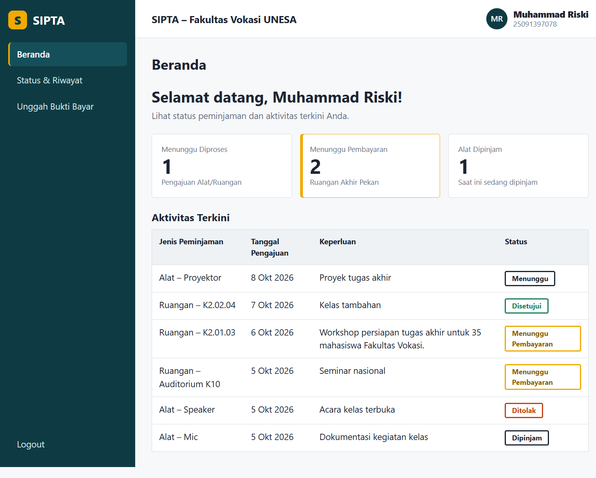
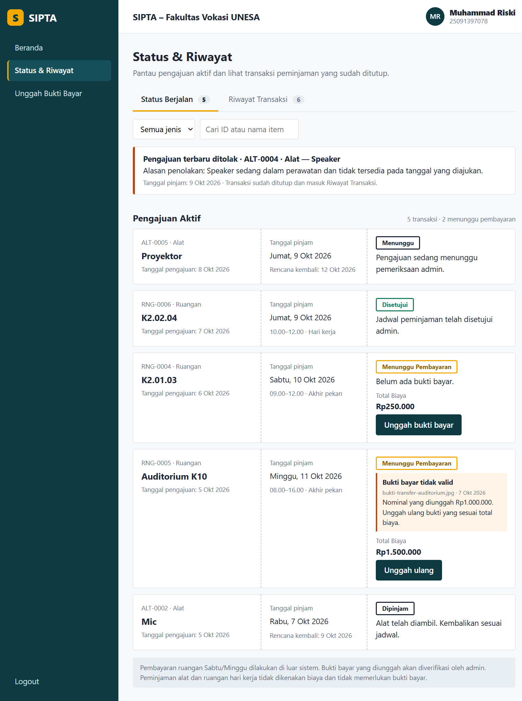
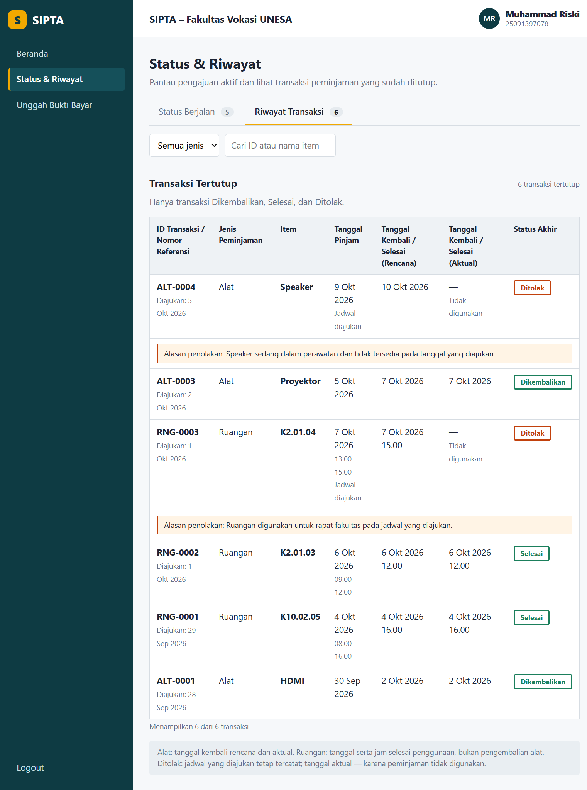
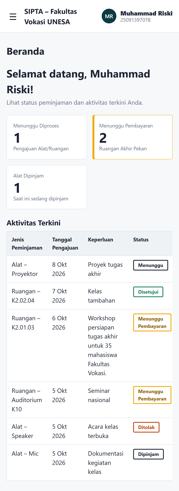
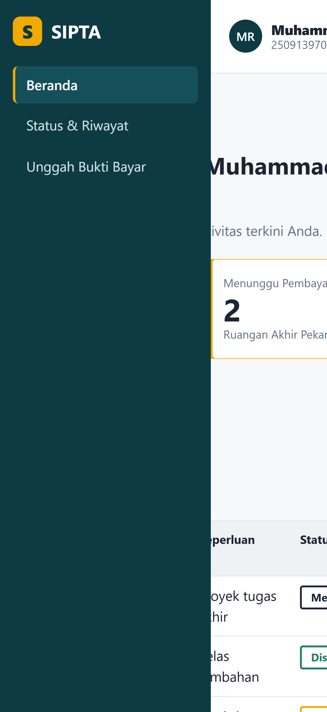
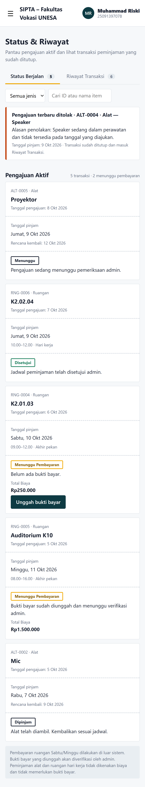
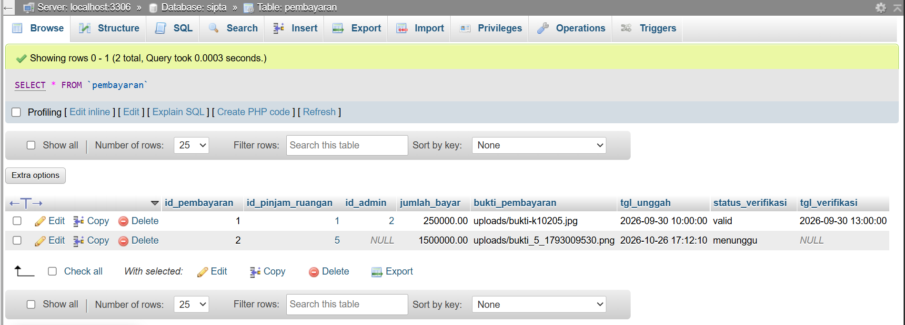

# PWUTS_C09_25091397078

**UTS Pemrograman Web – SIPTA (Sistem Peminjaman dan Sewa Alat dan Ruangan), Fakultas Vokasi UNESA**

| | |
| --- | --- |
| Nama | Muhammad Riski |
| NIM | 25091397078 |
| Kelas | D4 MI 2025C |
| Kelompok | C09 (SIPTA) |
| Dosen | Ari Kurniawan, S.Kom., M.T. |

## Bagian yang saya kerjakan

Alur **Status & Pembayaran** dari proposal kelompok. Alur Alat dan Ruangan dikerjakan anggota lain (kode dan tampilan dibuat sendiri-sendiri).

| Poin | Isi | File |
| --- | --- | --- |
| 2.a | Homepage/layout utama: sidebar, header, Beranda (ringkasan + aktivitas terkini), responsive. Menu memuat halaman dengan Ajax (`$.load`). | `index.html`, `css/style.css`, `js/main.js` |
| 2.b | Status & Riwayat: tab Status Berjalan (kartu) dan Riwayat Transaksi (tabel), banner pengajuan terbaru ditolak, filter jenis, pencarian ID/item. | `pages/konten.html`, `js/konten.js` |
| 2.c | Form unggah/unggah ulang bukti bayar dengan validasi jQuery sebelum submit ke server (`process.php`). | `pages/form.html`, `js/validasi.js`, `process.php` |

Validasi form: transaksi wajib dipilih, nominal harus angka dan sama dengan total biaya, bukti berformat JPG/PNG/PDF maksimal 2 MB. Server memvalidasi ulang sebelum menulis ke tabel `pembayaran`.

## Tampilan

**Beranda**


**Status Berjalan**


**Riwayat Transaksi**


**Form Unggah Bukti Bayar**


**Validasi form (contoh error)**


**Form berhasil dikirim**


## Tampilan mobile

| Beranda | Menu terbuka | Status |
| --- | --- | --- |
|  |  |  |

**Data tersimpan di database (tabel `pembayaran`)**


## Struktur folder

```txt
PWUTS_C09_25091397078/
├── index.html
├── README.md
├── sipta.sql          ← struktur + data contoh database
├── koneksi.php        ← koneksi MySQL
├── data.php           ← mengambil data transaksi (JSON)
├── process.php        ← menyimpan bukti bayar
├── css/style.css
├── js/  (main.js, konten.js, validasi.js)
├── pages/  (konten.html, form.html)
├── img/
├── screenshot/
└── uploads/           ← bukti bayar yang diunggah
```

## Cara menjalankan

Butuh PHP dan MySQL lokal (Laragon atau XAMPP). Ajax tidak berjalan lewat `file://`.

1. Salin folder ini ke `laragon/www/` (Laragon) atau `xampp/htdocs/` (XAMPP), lalu jalankan **Apache** dan **MySQL**.
2. Impor `sipta.sql`:
   - Laragon: buka Terminal Laragon, lalu `mysql -u root < sipta.sql` (atau HeidiSQL: File → Load SQL file).
   - XAMPP: buka `http://localhost/phpmyadmin` → Import → pilih `sipta.sql`.
3. Buka `http://localhost/PWUTS_C09_25091397078/`.

Database bernama `sipta`, user `root` tanpa password (default Laragon/XAMPP). Ubah di `koneksi.php` jika berbeda.

**Kalau muncul "Data gagal dimuat":** MySQL belum aktif atau `sipta.sql` belum diimpor.

## Catatan

- Dibuat dengan HTML, CSS, JavaScript/jQuery, PHP, dan MySQL. Tidak memakai Bootstrap atau framework CSS lain.
- Struktur tabel mengikuti proposal (8 tabel). Tampilan mengikuti wireframe; bagian wireframe yang tidak didukung struktur database proposal mengikuti proposal: ID transaksi diturunkan (`ALT-`/`RNG-` + nomor), dan alasan admin untuk bukti tidak valid tidak ditampilkan (tabel `pembayaran` tidak punya kolom alasan).
- Login belum ada. Mahasiswa contoh dipilih lewat `$ID_PENGGUNA` di `koneksi.php`, dan tombol Logout hanya simulasi tampilan.
